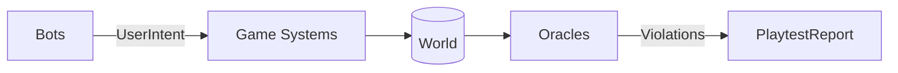

# bevy_playtest

An ECS-native, headless, in-process playtesting harness for [Bevy](https://bevy.org) games. Write WHAT to test, not WHEN to press.

**Targets Bevy 0.20** (`0.20.0` on crates.io). Uses the `MessageReader`/`MessageWriter` buffered-event API.

## Quick start (10 minutes)

bevy_playtest runs your game headlessly, drives it with bots, and checks
generic oracles — automated checks that watch the world for known
failure classes (crashes, log errors, soft-locks, NaNs, liveness) —
with **zero semantic contract**: no `TestApi`, no `IntentSurface`, no
game-code changes.

A *seed* fixes the bot's random input sequence: same seed, same
replayable run. Different seeds explore different input sequences.

**One line of test code, zero semantic contract:**

```rust,no_run
use bevy::prelude::*;
use bevy_playtest::autotest::{autotest, AutotestConfig};

# #[derive(Clone, Default)]
# struct MyGamePlugin;
# impl Plugin for MyGamePlugin {
#     fn build(&self, _: &mut App) {}
# }
# fn main() {
// tests/playtest.rs — runs 4 seeds × 5s of chaos with tier-0 oracles
// (AutotestConfig::thorough() = 16 seeds × 20s for release-grade runs)
let report = autotest(MyGamePlugin, AutotestConfig::default()).unwrap();
assert!(report.passed(), "{}", report.summary());
# }
```

Requirements for the in-process mode (stated up front):

- Your game needs a `src/lib.rs` exposing its root plugin, so an
  integration test can import it. (Binary-only crate? Promote your
  `main.rs` plugin setup into `lib.rs` — a mechanical refactor.)
- `headless_app()` strips the render/window/audio backends; your game
  systems still run each frame, they just have no window to draw to.
  Systems reading `Window` or camera output need a guard or the
  subprocess tier.
- Add bevy_playtest as a dev-dependency:

```toml
[dev-dependencies]
bevy_playtest = "0.1"
```

Then `cargo test --test playtest` — that's the whole wiring. A passing
run prints a summary line like
`autotest: 4 seeds, 0 failing runs (0 unique), 20s total, 100%, gate: pass`.

Once your first run passes, customize WHAT to check: the
[scenario JSON](docs/schema.json) tells the harness your invariants, and
the [Scenario Cookbook](docs/scenarios.md) walks through realistic examples.
[`ScenarioBuilder`](src/builder.rs) is the same thing in type-checked Rust.
Validate any scenario offline with `cargo bevy-playtest validate <file>` —
typos get did-you-mean suggestions before the game even builds:

```json
{
  "bot": { "type": "chaos", "seed": 42 },
  "duration_s": 10.0,
  "invariants": [
    { "name": "hp_floor", "rule": "custom", "path": "TestApi.hp",
      "check": "above", "value": 10 }
  ]
}
```

### Interpreting a failure report

A failing run writes `target/bevy_playtest/runs/<run-id>/report.json`.
The three fields to read first:

- `status` — `"fail"` / `"crash"` (a crashed run) / `"pass"`.
- `violations` — one entry per broken rule (see the
  [rule catalog](docs/rules.md)). Each entry carries the rule name, the
  first/last frame, a `detail` string with the offending values, and a
  stable `fingerprint` for regression tracking.
- `action_log` — every input the bots fired, frame-indexed, so the
  failing sequence can be replayed or minimized.

Example: a soft-lock shows up as a `stuck_after_intent` violation with
`detail: "no liveness within 0.5s after intent choice#2 (frame 214)"` —
the action log tells you exactly which input sequence got you there.

## Integration modes: on-ramp vs depth

Two paths, positioned as a funnel (full table in
[docs/reference-workspace.md §0](docs/reference-workspace.md)):

1. **On-ramp — zero-touch external BRP (Bevy Remote Protocol) tier**: smoke-test any Bevy game
   in ~30 seconds with one documented build flag
   (`--features bevy/bevy_remote`). Ceiling is observe-only
   (crash/error/log/liveness/state-digest) — that ceiling is the
   trade-off for touching zero code.
2. **Depth — in-process `autotest(GamePlugin)`**: the richest mode,
   structurally and forever. Semantic contract, bit-exact replay,
   scheduler/RNG control, dense oracles via local queries. External
   tiers can approach but never replace it.

Start zero-touch, graduate to `autotest()` when you want bots, replay,
and typed oracles.

## Contract tiers (what "zero-contract" means)

The harness detects how deep your game's test contract goes and states
the resulting **tier** in every report (`report.scope.tier`):

| Tier | Requires | What you get |
|------|----------|--------------|
| `zero` | nothing — the game's plugin alone | raw-input chaos (arrows/WASD default surface), inferred gameplay entities, generic oracles (panic, liveness, NaN, bounds, frame-time) |
| `observable` | `Name` on gameplay entities, or `GameTypes` registered, or reflect-registered components | stable entity identity in reports/replays, per-entity percept paths, effect attribution |
| `semantic` | any of: `TestApi`/`TestApiResolver`, non-empty `IntentSurface`, typed oracles, `ResetHooks`/`CheatHooks`/`NamedIntents` | intent bots, typed oracles, planner goals, reset/cheat hooks, `TestApi.*` invariants |

Reports also list the oracle families that ran vs. could not run
(`scope.active` / `scope.inactive`, each with a reason) and how the
harness drove the game (`scope.actuators`: `intents`, `raw_input`,
`ui_monkey`).

- **zero-contract** = no semantic hooks required from the game. NOT a
  claim about typing effort: enabling a cargo feature (e.g.
  `bevy_remote`) is a thin build-time contract, and "zero hand-written
  lines" (CLI scaffolding) is convenience, not a guarantee.
- **zero game-code changes at runtime** — true for in-process mode, but
  requires a `lib.rs` target (see Quick start).
- A missing contract piece is NEVER a rejection reason by itself:
  scenarios that don't reference the missing pieces run fine, and the
  report states what was not checked.
- Actuator selection is automatic (intents when an `IntentSurface`
  exists, raw input otherwise) and can be forced per-scenario with
  `"actuator": "intents" | "raw" | "ui" | "auto"`.

Optional semantic pieces, in increasing depth:

1. `TestApi` resource implementing `TestApiResolve` — publish
   observable state (score, phase, hp) for invariants and planner
   goals; world percepts (`Resource:`/`Component:` paths) work with
   zero game-side setup
2. `IntentSurface` — declare your game's input verbs; the chaos bot
   samples only from it
3. `ResetHooks`, `CheatHooks`, genre markers
   (`TurnBased`/`RealTime`), `Gameplay` marker component

Games with none of these still work: reflection-based percepts and
auto-discovery calibration kick in, and the harness fails loudly rather
than passing vacuously when a contract piece it needs is missing.

## Documentation

Docs are organized by the [Diataxis](https://diataxis.fr) framework — see [docs/README.md](docs/README.md) for the full index:

- **Tutorials:** [your first playtest](docs/tutorial-first-playtest.md), [wire your game's TestApi](docs/tutorial-wiring-testapi.md)
- **How-to:** [debug a failing run](docs/howto-debug-failure.md), [add an invariant](docs/howto-add-invariant.md), [run in CI](docs/howto-ci-integration.md), [suppress known failures](docs/howto-suppress-known-failure.md), [smoke-test a third-party game](docs/howto-smoke-external-game.md)
- **Reference:** [rule catalog](docs/reference-rules.md), [contract tiers](docs/reference-contract-tiers.md), [scenario schema](docs/schema.json), [Scenario Cookbook](docs/scenarios.md)
- **Explanation:** [zero-contract philosophy](docs/explanation-zero-contract.md), [determinism strategy](docs/explanation-determinism.md), [architecture](docs/explanation-architecture.md)

Workspace layout, artifact paths, update mode (`BEVY_PLAYTEST_UPDATE`), versioning,
rule-name registry, and vocabulary are governed by
[docs/reference-workspace.md](docs/reference-workspace.md) — the single source of truth.

## What it does

See the [coverage explanation](docs/explanation-coverage.md) for the full
failure-class breakdown and capture mechanics.

Quick links to reference pages:

- **Golden snapshots** → [docs/reference-golden.md](docs/reference-golden.md)
- **Robustness margins (J1)** → [docs/reference-robustness.md](docs/reference-robustness.md)
- **Invariant DSL** → [docs/reference-invariant-dsl.md](docs/reference-invariant-dsl.md)
- **Security (agent)** → [docs/reference-security.md](docs/reference-security.md)
- **Single-scenario API** → [docs/reference-usage.md](docs/reference-usage.md)
- **Feature flags** → [docs/reference-usage.md](docs/reference-usage.md#feature-flags)



- **Bots** (chaos, replay, pursuit, planner) sample from your declared `IntentSurface` and write typed `UserIntent` messages
- **Game systems** consume those intents directly — same schedule, same binary, no adapter layer
- **Oracles** (frozen-world, frame-time anomaly, bounds checks, invariant DSL) watch the world and report violations
- **Synthetic input** is opt-in: `synthetic_pointer`/`synthetic_keyboard` bots drive the real `PointerInput`/`KeyPressInput` chain when a scenario asks for it
- The harness itself is pre/post-processing around the Bevy app — `run_scenario()` sets up, pumps the loop, then collects the report

## Invariant DSL (primary API)

See the [reference](docs/reference-invariant-dsl.md) for canonical wire forms and
aliases. The Rust-native `typed` system is experimental; JSON is stable for v0.1.

## CI integration (JUnit XML)

Emit JUnit XML for CI test reporters (GitHub Actions, GitLab, Jenkins):

```rust,ignore
let matrix = run_branch_matrix(build_app, vec![variant_a, variant_b])?;
std::fs::write("target/swarm-junit.xml", matrix.to_junit("swarm"))?;
```

Upload `target/swarm-junit.xml` as a CI artifact; autotest runs also
write `runs/<run-id>/junit.xml` automatically. See
[howto-ci-integration.md](docs/howto-ci-integration.md) for gate semantics.

## Testing

Two loops (see [reference-workspace.md](docs/reference-workspace.md)):

- **Outer loop (acceptance):** plain fixture games with ZERO bevy_playtest
  plumbing (`fixtures/*`) + JSON expectation files
  (`tests/swarm/expectations/<fixture>/<variant>.json`). The runner
  (`tests/acceptance.rs`) drives the fixture-runner binary — the same
  path a user takes — and asserts on the report JSON contract
  (`docs/report-schema.json`). Bug variants are selected at runtime via
  the `FIXTURE_BUG` env var, so clean and buggy share one build.
- **Inner loop (unit):** module tests inside `src/` for algorithms (determinism, fingerprints, oracles)
  and semantics.

To add a fixture: create `fixtures/<game>/` (depends on bevy ONLY),
add an adapter + arm in `tests/fixture-runner`, and write expectation
files under `tests/swarm/expectations/<game>/` (clean.json is the
false-positive guard; every `bug_<name>.json` documents a planted bug).

## Development

```bash
cargo test              # ~200 lib tests
cargo test --tests       # integration/regression suites
cargo test --features agent
cargo clippy --all-targets -- -D warnings
```

Requires Bevy 0.20 with the `debug` feature for real system names.

## Determinism

See the [determinism explanation](docs/explanation-determinism.md) for the full
strategy, entropy hook, and sharp edges.

```rust,ignore
let report = bevy_playtest::determinism::check_determinism(build_app, &scenario, 2)?;
if !report.is_deterministic() {
    println!("{:?}", report.first_divergence);
}
```

Games contribute custom digest parts (RNG state, AI blackboards) via the
`DigestHooks` resource. Normal runs pay nothing — digests are only recorded
when a `StateTrace` resource is present.

## Bevy compatibility

| bevy_playtest | Bevy | cargo-bevy-playtest |
|---------------|------|---------------------|
| 0.1           | 0.20 | 0.1                 |

Policy: each bevy_playtest minor tracks exactly one Bevy minor; for now only
the latest supported Bevy minor is targeted. Version-agnostic plans (BRP and
other decoupling work) are tracked separately and are not part of this policy.

Building with a different Bevy minor alongside bevy_playtest fails with a
duplicate-crate error:

```text
error: failed to select a version for `bevy_ecs`.
  ... two versions of crate `bevy_ecs` found ...
```

Fix: pin your game and bevy_playtest to the same Bevy minor (the table above).

## Robustness margins (J1)

See the [robustness reference](docs/reference-robustness.md) for the full ρ
semantics by invariant kind.

## Security (agent feature)

See the [security reference](docs/reference-security.md) for threat model,
token setup, and the design decision context.

## Contributing

Contributions are welcome! Unless you explicitly state otherwise, any
contribution intentionally submitted for inclusion in the work by you,
as defined in the Apache-2.0 license, shall be dual licensed as above,
without any additional terms or conditions.

## License

Licensed under either of

- Apache License, Version 2.0, ([LICENSE-APACHE](LICENSE-APACHE) or
  <http://www.apache.org/licenses/LICENSE-2.0>)
- MIT license ([LICENSE-MIT](LICENSE-MIT) or
  <http://opensource.org/licenses/MIT>)

at your option.

Unless you explicitly state otherwise, any contribution intentionally
submitted for inclusion in the work by you, as defined in the
Apache-2.0 license, shall be dual licensed as above, without any
additional terms or conditions.

