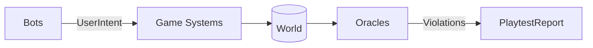

# bevy_swarm

[](https://github.com/sponsors/mcanevet)

An ECS-native, headless, in-process playtesting harness for [Bevy](https://bevy.org) games. Write WHAT to test, not WHEN to press.

**Targets Bevy 0.20** (`0.20.0` on crates.io). Uses the `MessageReader`/`MessageWriter` buffered-event API.

## Quick start (10 minutes)

bevy_swarm runs your game headlessly, drives it with bots, and checks
generic oracles (crashes, log errors, soft-locks, NaNs, liveness) — with
**zero semantic contract**: no `TestApi`, no `IntentSurface`, no game-code
changes.

**One line of test code, zero semantic contract:**

```rust,no_run
use bevy::prelude::*;
use bevy_swarm::autotest::{autotest, AutotestConfig};

# #[derive(Clone, Default)]
# struct MyGamePlugin;
# impl Plugin for MyGamePlugin {
#     fn build(&self, _: &mut App) {}
# }
# fn main() {
// tests/playtest.rs — runs 16 seeds × 20s of chaos with tier-0 oracles
let report = autotest(MyGamePlugin, AutotestConfig::default()).unwrap();
assert!(report.failures.is_empty(), "{}", report.summary());
# }
```

Requirements for the in-process mode (stated up front):

- Your game needs a `src/lib.rs` exposing its root plugin, so an
  integration test can import it. (Binary-only crate? Promote your
  `main.rs` plugin setup into `lib.rs` — a mechanical refactor.)
- `headless_app()` strips the render/window/audio backends; systems
  reading window state need a guard or the subprocess tier.
- Add bevy_swarm as a dev-dependency:

```toml
[dev-dependencies]
bevy_swarm = "0.1"
```

Then `cargo test --test playtest` — that's the whole wiring. The
[scenario JSON](docs/schema.json) tells the harness WHAT to check; the
[Scenario Cookbook](docs/scenarios.md) walks through realistic examples,
and [`ScenarioBuilder`](src/builder.rs) is the same thing in Rust.
Validate any scenario offline with `cargo swarm validate <file>` —
typos get did-you-mean suggestions before the game even builds:

```json
{
  "bot": { "type": "chaos", "seed": 42 },
  "duration_s": 10.0,
  "invariants": [
    { "name": "hp_floor", "rule": "custom", "path": "TestApi.hp",
      "check": "above", "value": 10 }
  ]
}
```

### Interpreting a failure report

A failing run writes `target/bevy_swarm/runs/<run-id>/report.json`.
The three fields to read first:

- `status` — `"fail"` / `"crash"` (a crashed run) / `"pass"`.
- `violations` — one entry per broken rule (see the
  [rule catalog](docs/rules.md)). Each entry carries the rule name, the
  first/last frame, a `detail` string with the offending values, and a
  stable `fingerprint` for regression tracking.
- `action_log` — every input the bots fired, frame-indexed, so the
  failing sequence can be replayed or minimized.

Example: a soft-lock shows up as a `stuck_after_intent` violation with
`detail: "no liveness within 0.5s after intent choice#2 (frame 214)"` —
the action log tells you exactly which input sequence got you there.

## Integration modes: on-ramp vs depth

Two paths, positioned as a funnel (full table in
[docs/conventions.md §0](docs/conventions.md)):

1. **On-ramp — zero-touch external BRP tier**: smoke-test any Bevy game
   in ~30 seconds with one documented build flag
   (`--features bevy/bevy_remote`). Ceiling is observe-only
   (crash/error/log/liveness/state-digest) — that ceiling is the
   trade-off for touching zero code.
2. **Depth — in-process `autotest(GamePlugin)`**: the richest mode,
   structurally and forever. Semantic contract, bit-exact replay,
   scheduler/RNG control, dense oracles via local queries. External
   tiers can approach but never replace it.

Start zero-touch, graduate to `autotest()` when you want bots, replay,
and typed oracles.

## Contract tiers (what "zero-contract" means)

The harness detects how deep your game's test contract goes and states
it in every report (`report.scope.tier`), along with the oracle
families that ran vs. could not run (`scope.active` /
`scope.inactive`, each with a reason) and how the harness drove the
game (`scope.actuators`: `intents`, `raw_input`, `ui_monkey`).

| Tier | Requires | What you get |
|------|----------|--------------|
| `zero` | nothing — the game's plugin alone | raw-input chaos (arrows/WASD default surface), inferred gameplay entities, generic oracles (panic, liveness, NaN, bounds, frame-time) |
| `observable` | `Name` on gameplay entities, or `GameTypes` registered, or reflect-registered components | stable entity identity in reports/replays, per-entity percept paths, effect attribution |
| `semantic` | any of: `TestApi`/`TestApiResolver`, non-empty `IntentSurface`, typed oracles, `ResetHooks`/`CheatHooks`/`NamedIntents` | intent bots, typed oracles, planner goals, reset/cheat hooks, `TestApi.*` invariants |

- **zero-contract** = no semantic hooks required from the game. NOT a
  claim about typing effort: enabling a cargo feature (e.g.
  `bevy_remote`) is a thin build-time contract, and "zero hand-written
  lines" (CLI scaffolding) is convenience, not a guarantee.
- **zero game-code changes at runtime** — true for in-process mode, but
  requires a `lib.rs` target (see Quick start).
- A missing contract piece is NEVER a rejection reason by itself:
  scenarios that don't reference the missing pieces run fine, and the
  report states what was not checked.
- Actuator selection is automatic (intents when an `IntentSurface`
  exists, raw input otherwise) and can be forced per-scenario with
  `"actuator": "intents" | "raw" | "ui" | "auto"`.

Optional semantic pieces, in increasing depth:

1. `TestApi` resource implementing `TestApiResolve` — publish
   observable state (score, phase, hp) for invariants and planner
   goals; world percepts (`Resource:`/`Component:` paths) work with
   zero game-side setup
2. `IntentSurface` — declare your game's input verbs; the chaos bot
   samples only from it
3. `ResetHooks`, `CheatHooks`, genre markers
   (`TurnBased`/`RealTime`), `Gameplay` marker component

Games with none of these still work: reflection-based percepts and
auto-discovery calibration kick in, and the harness fails loudly rather
than passing vacuously when a contract piece it needs is missing.

## Documentation

Docs are organized by the [Diataxis](https://diataxis.fr) framework — see [docs/README.md](docs/README.md) for the full index:

- **Tutorials:** [your first playtest](docs/tutorial-first-playtest.md), [wire your game's TestApi](docs/tutorial-wiring-testapi.md)
- **How-to:** [debug a failing run](docs/howto-debug-failure.md), [add an invariant](docs/howto-add-invariant.md), [run in CI](docs/howto-ci-integration.md), [suppress known failures](docs/howto-suppress-known-failure.md), [smoke-test a third-party game](docs/howto-smoke-external-game.md)
- **Reference:** [rule catalog](docs/reference-rules.md), [contract tiers](docs/reference-contract-tiers.md), [scenario schema](docs/schema.json), [Scenario Cookbook](docs/scenarios.md)
- **Explanation:** [zero-contract philosophy](docs/explanation-zero-contract.md), [determinism strategy](docs/explanation-determinism.md), [architecture](docs/explanation-architecture.md)

Workspace layout, artifact paths, update mode (`BEVY_SWARM_UPDATE`), versioning,
rule-name registry, and vocabulary are governed by [docs/conventions.md](docs/conventions.md)
— the single source of truth. Oracle rule names live in the generated
[rule catalog](docs/rules.md) (`bevy_swarm::rules`); the scenario format
is specified by the generated [schema](docs/schema.json).

## Gameplay Snapshot Testing (Z11)

Record and compare per-frame state digests to detect gameplay regressions across versions:

```rust,no_run
use bevy_swarm::golden::{record_golden, check_golden, GoldenSet, Tolerance};
use bevy_swarm::scenario::Scenario;
use bevy::prelude::App;

# fn main() {
// Record a baseline (once):
let scenarios: Vec<Scenario> = vec![];
record_golden(|| App::new(), &scenarios, "tests/swarm/golden").unwrap();

// Check against goldens (in CI or tests):
let set = GoldenSet::load("tests/swarm/golden").unwrap();
let report = check_golden(|| App::new(), &set, &Tolerance::default()).unwrap();
assert!(report.all_same(), "no regressions");
# }
```

- **Approval workflow**: Set `BEVY_SWARM_UPDATE=golden` (or `all`) to rewrite golden files; commit the diff for review. `BEVY_SWARM_UPDATE` unset means read-only.
- **Determinism required**: Run `check_determinism` first; nondeterministic scenarios are flagged.
- **Tolerance**: float tolerance smooths timing/platform noise; same-platform digest mismatches are still failures (platform is not compared separately).
- **Readable diffs**: If your game exposes state via `TestApi`, diffs show field names/values instead of raw hashes.

## What it does

- **Typed intent bots** — chaos (with uniform/aggressive/curious/idle personas), replay, pursuit, planner (aplib-style goal trees), synthetic_pointer and synthetic_keyboard (drive the REAL input chain through picking/ButtonInput, not shortcuts)
- **Invariant DSL** — scenario JSON with bounds checks, TestApi predicates, eventual assertions, query-target entity counts, differential rules (no_decrease/no_increase), rate limits, expert-rule oracles (WHEN/REQUIRE)
- **Oracles** — frozen-world soft-lock detection, Welford frame-time anomaly detection, true rolling p99, readiness gate, finite-transform NaN check (all entities, not only Gameplay)
- **CA² system coverage** — which registered systems actually executed, with zero instrumentation (wrap-safe schedule tick-age snapshots)
- **Failure minimization** — ddmin over the structured action log shrinks ANY failure (crashes and invariant violations) to a ready-to-save regression scenario with a trimmed duration, and fails honestly with `NotReproducible` when the log alone cannot reproduce the failure
- **Calibration** — `diagnostics::calibrate_world` runs a chaos session and derives suggested invariants from archetype-count envelopes, with zero game annotations (library API; there is no CLI flag)
- **Loud contracts** — missing picking backends, unresolved TestApi paths, vacuous setups REJECT the scenario instead of silently passing

## What we capture (panics, logs, background threads)

- **ECS-thread panics** — systems, observers, commands: fully captured
  with system-name attribution (via the tracing span when built with
  `trace`), severity, and location.
- **bevy_tasks pool-thread panics** (IoTaskPool, AsyncComputeTaskPool,
  ComputeTaskPool) — captured and reported with target `pool_thread`.
  Game code routinely detaches background work (asset decode,
  pathfinding); those panics used to escape the harness entirely.
- **Logs** — WARN/ERROR records from any thread with a run active.
- **At run end** the harness waits a bounded grace window (300 ms) for
  detached pool work to land before draining sinks, so late panics
  aren't lost.
- **Known limitation (cross-seed stragglers)**: task pools are
  process-global and never shut down between seeds. A straggler task
  from seed N that completes during seed N+1 is attributed to the
  run active when it lands. For strict isolation, use the external
  subprocess tiers (smoke / BRP-driven).

## Usage (single scenario)

```rust,no_run
use bevy_swarm::harness::{run_scenario, Scenario};

# fn main() -> Result<(), Box<dyn std::error::Error>> {
let scenario: Scenario = serde_json::from_str(
    r#"{"bot":{"type":"planner","goals":{"kind":"primitive","path":"TestApi.score","check":"above","value":3,"emit":[{"intent":"choice","index":0}]}},"duration_s":1.0,"invariants":[]}"#,
)?;

let mut app = build_your_headless_app(); // your game's plugins + PlaytestPlugin
let report = run_scenario(&mut app, &scenario)?;
assert_eq!(report.status, bevy_swarm::enums::PlaytestStatus::Pass);
# Ok(())
# }
# fn build_your_headless_app() -> bevy::prelude::App { unimplemented!() }
```

## Game-side contract (deliberately thin)

See "Contract tiers" above for the full picture.

## Feature flags

- `agent` — BRP-based resident agent for live inspection and intent injection

## Feature-gated modes

In-process mode (Quick start above) is the primary integration. The
external/subprocess tiers are on the roadmap (see docs/conventions.md
§0 for the full modes table); on current Bevy 0.20 the external
observe-only BRP tier works with `--features bevy/bevy_remote` on the
game side.

## Architecture

At its core, the data flow per frame:



- **Bots** (chaos, replay, pursuit, planner) sample from your declared `IntentSurface` and write typed `UserIntent` messages
- **Game systems** consume those intents directly — same schedule, same binary, no adapter layer
- **Oracles** (frozen-world, frame-time anomaly, bounds checks, invariant DSL) watch the world and report violations
- **Synthetic input** is opt-in: `synthetic_pointer`/`synthetic_keyboard` bots drive the real `PointerInput`/`KeyPressInput` chain when a scenario asks for it
- The harness itself is pre/post-processing around the Bevy app — `run_scenario()` sets up, pumps the loop, then collects the report

## Invariant DSL (primary API)

The **JSON invariant language** in scenarios is the ONE supported way
to express checks (`check`, `value`, `query`, `path`, windows
`after_s`/`before_s`/`eventually_s`). It parses into one `CheckOp`
enum everywhere: wire format `lt`, `le`, `gt`, `ge`, `equals`, `ne`
(legacy aliases `below` = `le`, `above` = `ge`, `eq` = `equals`; all
inclusive boundaries). Calibration output
(`generate_invariants_from_calibration`) emits exactly this dialect —
round-trip guaranteed by test.

`bevy_swarm::typed` (Rust-native oracle/predicate/policy systems) is
**experimental**: usable, but expect breaking changes without a major
version bump; the JSON DSL is the stable surface for v0.1.

## CI integration (JUnit XML)

Emit JUnit XML for CI test reporters (GitHub Actions, GitLab, Jenkins):

```rust,ignore
let matrix = run_branch_matrix(build_app, vec![variant_a, variant_b])?;
std::fs::write("target/swarm-junit.xml", matrix.to_junit("swarm"))?;
```

Upload `target/swarm-junit.xml` as a CI artifact; autotest runs also
write `runs/<run-id>/junit.xml` automatically.

## Testing

Two loops (see docs/conventions.md):

- **Outer loop (acceptance):** plain fixture games with ZERO bevy_swarm
  plumbing (`fixtures/*`) + JSON expectation files
  (`tests/swarm/expectations/<fixture>/<variant>.json`). The runner
  (`tests/acceptance.rs`) drives the fixture-runner binary — the same
  path a user takes — and asserts on the report JSON contract
  (`docs/report-schema.json`). Bug variants are selected at runtime via
  the `FIXTURE_BUG` env var, so clean and buggy share one build.
- **Inner loop (unit):** module tests inside `src/` for algorithms (determinism, fingerprints, oracles)
  and semantics.

To add a fixture: create `fixtures/<game>/` (depends on bevy ONLY),
add an adapter + arm in `tests/fixture-runner`, and write expectation
files under `tests/swarm/expectations/<game>/` (clean.json is the
false-positive guard; every `bug_<name>.json` documents a planted bug).

## Development

```bash
cargo test              # ~200 lib tests
cargo test --tests       # integration/regression suites
cargo test --features agent
cargo clippy --all-targets -- -D warnings
```

Requires Bevy 0.20 with the `debug` feature for real system names.

## Determinism

Replay, minimization, and seed sweeps are only trustworthy if a scenario is
deterministic. `check_determinism` verifies it (ggrs-SyncTest style): the
scenario runs multiple times on fresh `App`s and per-frame canonical state
digests are compared. On divergence you get the first divergent frame and
the differing fields (e.g. `Gameplay[Ball].translation.x`):

```rust,ignore
let report = bevy_swarm::determinism::check_determinism(build_app, &scenario, 2)?;
if !report.is_deterministic() {
    println!("{:?}", report.first_divergence);
}
```

Games contribute custom digest parts (RNG state, AI blackboards) via the
`DigestHooks` resource. Normal runs pay nothing — digests are only recorded
when a `StateTrace` resource is present.

### Z14: Deterministic Entropy Hook

Enable the `deterministic-entropy` feature and set the `getrandom_backend` cfg:

```bash
RUSTFLAGS='--cfg getrandom_backend="custom"' cargo test --features bevy_swarm/deterministic-entropy
```

(planned: a `cargo swarm run` wrapper that sets both automatically)

The custom backend hook (`__getrandom_v03_custom`) intercepts all `getrandom`
calls (including `rand::rng()`, `uuid::Uuid::new_v4`, `bevy_rand`) and draws
from a deterministic stream seeded from the scenario seed. Calls outside
`enter_run()` draw from a process-global fallback stream and increment the
`entropy_unattributed_draws` informational rule counter.

**Important**: `rand::rng()` uses `ThreadRng`, which is cached per thread.
To guarantee determinism across runs, **each scenario must run on a fresh
thread**. The matrix runner (`run_scenarios_parallel`) does this
automatically. Direct callers of `run_scenario` must either: (a) spawn a
fresh thread per call, or (b) document that they accept the risk of
cross-run ThreadRng state leakage. The `InProcess` runner now calls
`enter_run` before the factory so plugin-build draws are seeded.

**Important**: The hook signature must match exactly:
```rust,ignore
#[unsafe(no_mangle)]
pub unsafe extern "Rust" fn __getrandom_v03_custom(
    dest: *mut u8,
    len: usize,
) -> Result<(), getrandom::Error>
```

Using `extern "C"` or returning `Result<(), ()>` is undefined behavior (UB)
and will abort the process on panic.

## Robustness margins (J1)

Every invariant carries a **signed robustness ρ** — the STL-style distance to
violation: positive when satisfied ("never violated, but came within 0.3 of the
bound"), negative when violated. `report.robustness` holds:

- `per_invariant`: for each invariant, `(min ρ over run, frame of worst, normalized min)`
- `overall`: min of normalized mins across all invariants (< 0 iff the run failed)

Units normalize via an optional `scale` field (default `max(|threshold|, 1.0)`;
bounds use the half-width) so pixel-scale bounds don't swamp HP-scale ones.

**Semantics by invariant kind:**

| Invariant | Robustness ρ |
|-----------|-------------|
| `below`/`le` thr | `thr - v` |
| `above`/`ge` thr | `v - thr` |
| `lt`/`gt` | same as `le`/`ge` (strictness matters at ρ = …) |
| `equals` thr | `-(distance)` (0 when exact) |
| text `equals` | `+1` if equal, else `-1` (boolean lift) |
| `bounds` (per entity) | `min over axes of min(v - lo, hi - v)`; aggregated `min` over entities |
| `count` query | threshold margin on the count |
| `no_decrease` | `v_t - v_{t-1}` (min over run) |
| `max_delta_per_sec` | `max_dps - rate` |
| `eventually` (deadline D) | `max over t≤D of ρ_inner(t)` (best value so far) |
| expert `WHEN→REQUIRE` | `max(-ρ_W, ρ_R)` (anti-masking) |
| always-mode (default) | run-level ρ = `min over t of ρ(t)` |

Boolean verdict is exactly `ρ < 0` (or `ρ ≤ 0` for strict ops); this equivalence
is enforced by `debug_assert!` in the oracle so semantics can't drift.

```json
{"invariants": [{"name": "hp_floor", "rule": "custom", "path": "TestApi.hp",
                 "check": "above", "value": 10, "scale": 100}]}
```

This continuous signal is the substrate for future guided search (choice
mutation, Go-Explore) and LLM falsifiers.

## Security (agent feature)

The `agent` feature exposes BRP (arbitrary world reads and **mutation**) over
HTTP. Threat model: **the agent is an open debugger gated by a shared secret,
safe on loopback only**. Remote use additionally requires a TLS-terminating
proxy — the HTTP transport is plaintext.

- Binds to `127.0.0.1:15702` by default; non-loopback addresses are refused
  unless `AgentConfig { allow_remote: true, .. }` is set explicitly.
- **Default-deny**: a token is ALWAYS required for `playtest/*` methods.
  Configure one via `AgentConfig::token` or the `BEVY_SWARM_AGENT_TOKEN`
  env var. When neither is set, a cryptographically random session token
  is generated and printed to stderr at startup (eprintln, so it survives
  even when the plugin is added before `LogPlugin`).
- Token comparison is constant-time; an explicitly-empty configured token
  is treated as unset and does not authenticate `{token: ""}`.
- Release builds with the agent active log a loud warning; set
  `deny_in_release: true` to panic instead. Never ship agent-enabled builds.

**Experimental features** (known limitations, see docs):
- `autotest()` — false positives on default intent keys and static games (RF8)
- raw input (gamepad/pointer injection) — gamepad actions not in the audit log (RF16)
- `ClickEntity`/pointer picking — `NoViewportSize` failures without a camera (RF11)
- deterministic entropy — `rand::rng()` not reproducible on the same thread (RF10)

## Contributing

Contributions are welcome! By submitting a contribution you agree it is
licensed under **MIT OR Apache-2.0**, at the option of the project. There is
no CLA; this preserves the project's freedom to adjust licensing of future
versions (existing versions remain MIT/Apache-2.0 forever).

## License

Licensed under either of

- Apache License, Version 2.0, ([LICENSE-APACHE](LICENSE-APACHE) or
  <http://www.apache.org/licenses/LICENSE-2.0>)
- MIT license ([LICENSE-MIT](LICENSE-MIT) or
  <http://opensource.org/licenses/MIT>)

at your option.

Unless you explicitly state otherwise, any contribution intentionally
submitted for inclusion in the work by you, as defined in the
Apache-2.0 license, shall be dual licensed as above, without any
additional terms or conditions.

bevy_swarm is a **permanent open-core library**: the core crate stays
MIT/Apache-2.0 forever. Any future commercial surface (hosted runners,
LLM backends, portals) would live in separate companion products with
their own licenses — never a relicense of this crate.

## Sponsor

bevy_swarm is free (MIT/Apache-2.0). If your studio ships with it,
consider [sponsoring @mcanevet](https://github.com/sponsors/mcanevet).
