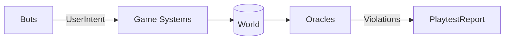

# Explanation: Architecture

*Understanding-oriented — how the harness sits inside your Bevy app,
and how each failure-detection mechanism works.*

## The one-paragraph model

bevy_swarm is pre/post-processing around a Bevy `App` — not a
separate process, not a driver outside your game. Per frame:

Bots write typed `UserIntent` messages into the SAME schedule your
input systems read; your systems mutate the world as usual; oracles
observe the world after each tick and accumulate violations;
`run_scenario()` collects everything into the report. No adapter
layer, no synthetic DOM, no screenshot diffing.

## Anatomy of a run

1. **App construction** — `headless_app()` builds a Bevy `App` with
   the game's plugins plus `PlaytestPlugin`. Render/window/audio
   backends are stripped (`src/headless_strip.rs`); scheduling runs
   on `SingleThreadedExecutor`.
2. **Bot loop** — bots (chaos, replay, pursuit, planner) sample
   their strategy each tick:
   - chaos picks random intents (uniform/aggressive/curious/idle
     personas) from the `IntentSurface` or raw-key surface
   - planner walks a goal tree, emitting intents that might satisfy
     the current predicate
   - synthetic_pointer / synthetic_keyboard drive the REAL input
     chain (picking, `ButtonInput`) — opt-in, when a scenario wants
     the actual UI pathway
   Every input lands in the **action log**, frame-indexed.
3. **Oracle tick** — oracles run as schedule systems reading the
   world AFTER game systems each frame: frozen-world detection,
   frame-time statistics (Welford), NaN sweeps, bounds checks, the
   invariant DSL evaluator.
4. **Teardown** — bounded grace window (300 ms) for detached pool
   work to land, sinks drained, report assembled.

## The rule pipeline

Everything the harness reports on is a **rule** (the `Rule` enum —
50 rules, see the [catalog](reference-rules.md)). Each has a kind:
`major` (gates) or `informational` (reported, never gates). Rule
names are a closed registry — expectation files and suppression
reference only these names, and `docs/rules.md` is generated from
the enum to prevent drift.

Violations are deduplicated per run by **fingerprint** — a stable
hash of rule + scenario context (NOT seed or frame), so the same
bug across 16 seeds is one fingerprint, and regression tracking
works across weeks.

## Panic and log capture

An ECS panic unwinds through Bevy's executor — normally killing the
run before the report is written. The harness installs a panic hook
and drain strategy covering:

- **ECS-thread panics** (systems, observers, commands) with
  system-name attribution and severity
- **Pool-thread panics** — `bevy_tasks` pools (Io/AsyncCompute/
  Compute) run game work in background threads; those panics are
  captured and reported under target `pool_thread`
- **Logs** — WARN/ERROR records from any thread while a run is
  active, via a tracing layer (works alongside the game's own
  `LogPlugin`)

Known limit: task pools are process-global, so a straggler from
seed N can land during seed N+1 (attributed to whichever run is
live). Strict isolation needs the external subprocess tiers.

## Failure minimization

Given a failing run, ddmin shrinks the action log: delete halves of
the input sequence, replay, keep deletions that still fail. The
result — smallest reproducing subsequence + trimmed duration — is
emitted as a standalone `regression-<seed>-<rule>.json`, ready to
commit. Unreproducible failures raise `NotReproducible` instead of
lying.

## Coverage without instrumentation

CA² snapshots wrap-safe schedule tick-age counters to determine
which registered systems actually executed during a run — zero
instrumentation. Feeds the `coverage.discovered_surface` and dead
input detection (`dead_verb`, `dead_widget`).

## Determinism substrate

Per-frame state digests (computed only when `StateTrace` is
present) power `check_determinism`, golden snapshot testing, and
replay verification — see the
[determinism explanation](explanation-determinism.md).

## The agent feature (experimental)

With the `agent` feature, a BRP server (loopback by default,
default-deny token) exposes world reads, `playtest/*` methods, and
live intent injection — the same primitives the bots use, for
LLM-driven or interactive investigation. Threat model: an open
debugger, safe on loopback only.

## Code map

| Area | Path |
|---|---|
| Scenario DSL + schema | `src/scenario.rs` |
| Builder API | `src/builder.rs` |
| Orchestration / run loop | `src/harness.rs`, `src/driver.rs` |
| Oracles | `src/rules.rs`, `src/state.rs` |
| Headless strip | `src/headless_strip.rs` |
| Determinism / entropy | `src/determinism.rs` |
| Minimization | `src/minimize.rs` |
| Autotest aggregation | `src/autotest.rs` |
| Golden snapshots | `src/golden.rs` |
| Rule registry | `src/rules.rs` (generates `docs/rules.md`) |
| CLI (init/run/validate/report/reproduce) | `cargo-bevy-swarm/` |
